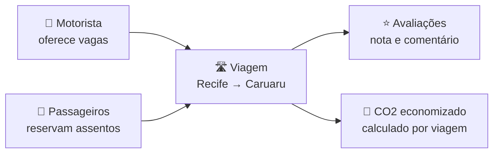
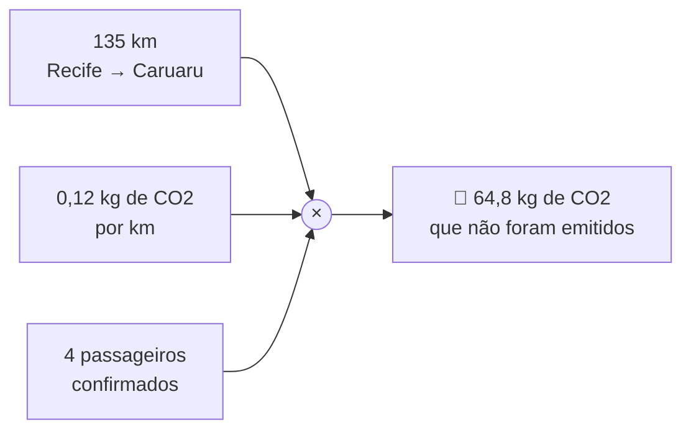
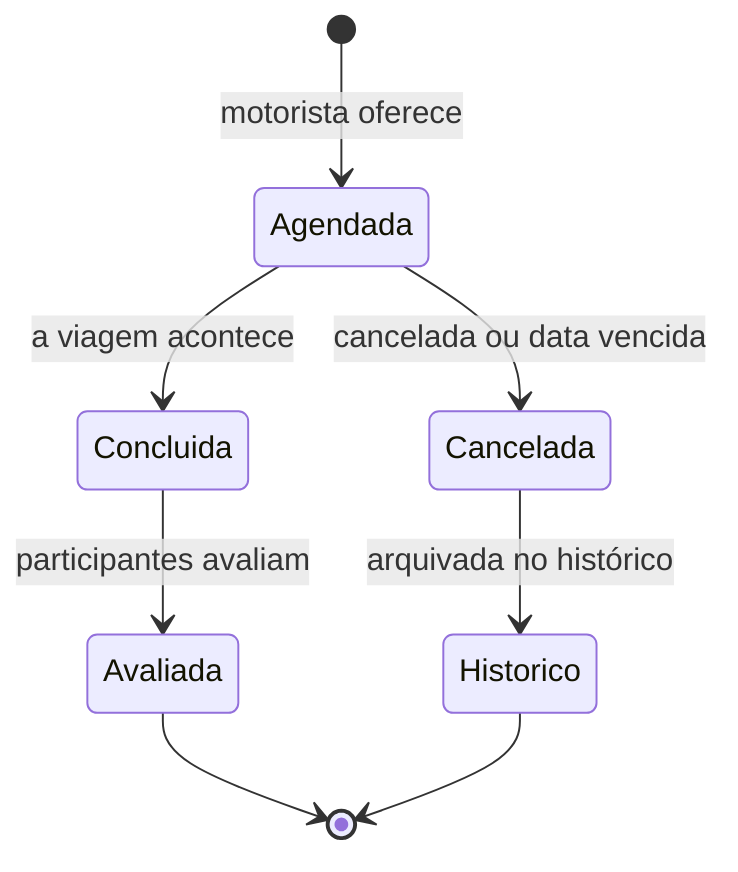
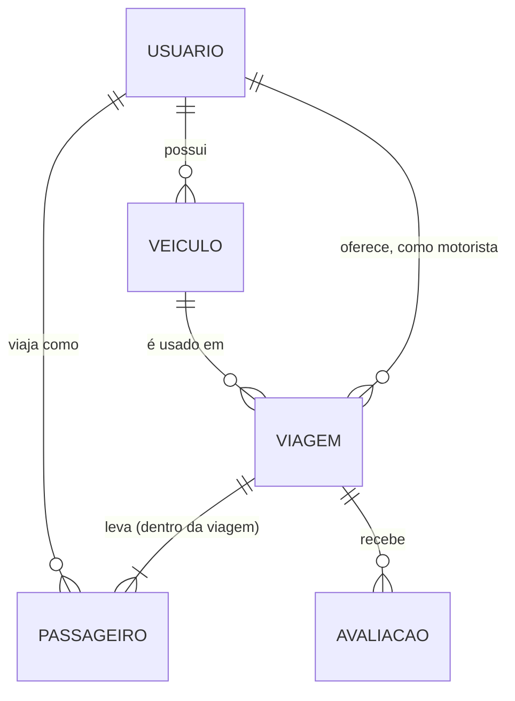
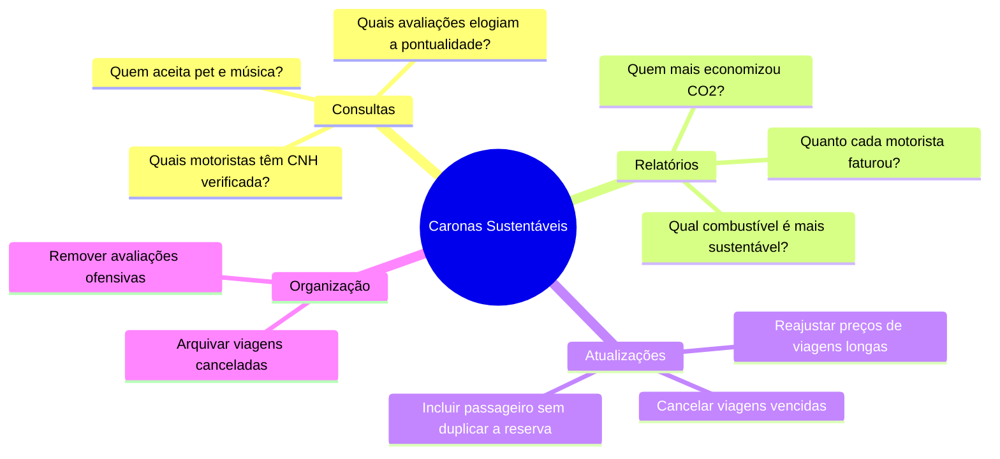
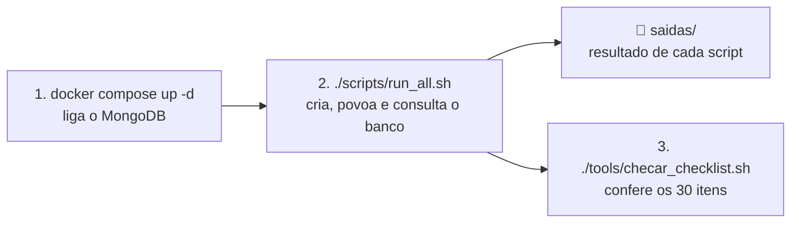

# Plataforma de Caronas Sustentáveis (MongoDB)

Projeto da disciplina IF685 Gerenciamento de Dados e Informação (CIn/UFPE, 2026.2): o banco de dados de uma plataforma de caronas para a Região Metropolitana do Recife e o Agreste.

## A ideia em poucas palavras

Muita gente faz o mesmo trajeto todo dia, cada um no seu carro e com assentos vazios. Na plataforma, quem já vai viajar oferece essas vagas, e quem precisa ir para o mesmo lugar reserva um assento e divide o custo. Cada passageiro que deixa o carro em casa é um carro a menos na rua, e a plataforma calcula quanto CO2 deixou de ser emitido em cada viagem.



## Quanto CO2 uma carona economiza

A conta adotada é simples: cada passageiro confirmado evita um carro rodando, e um carro emite em média 0,12 kg de CO2 por km.



## A vida de uma viagem

Toda viagem começa agendada. Depois, ou ela acontece e recebe avaliações, ou é cancelada (pelo motorista ou porque a data passou) e vai para um histórico.



## O que o banco guarda

São quatro grupos de informação. A viagem guarda dentro dela a lista de passageiros, porque os dois são sempre consultados juntos.



| Grupo | O que tem |
|---|---|
| Usuários | Quem usa a plataforma: nome, contato, cidade e preferências como "sem fumo" ou "pet friendly". Motoristas têm a CNH verificada. |
| Veículos | Os carros de cada motorista, com combustível. Elétricos e híbridos são marcados como verdes. |
| Viagens | Origem, destino, paradas, data, preço, vagas e os passageiros com o status da reserva. |
| Avaliações | Nota de 1 a 5 e comentário, que podem ser pesquisados por palavras. |

## Perguntas que o projeto responde

Os scripts fazem 36 operações, cada uma ligada a uma pergunta do dia a dia da plataforma:



## Como rodar

Só é preciso ter o Docker instalado. Não precisa instalar o MongoDB: tudo roda dentro de um container.



```bash
docker compose up -d          # 1. liga o MongoDB (container mongo-caronas)
./scripts/run_all.sh          # 2. executa todos os scripts em ordem
./tools/checar_checklist.sh   # 3. confere os 30 itens da checklist (requer Python 3)
```

O `run_all.sh` apaga e recria o banco a cada execução e usa dados gerados com semente fixa, então rodar duas vezes dá exatamente o mesmo resultado. Para executar um script isolado:

```bash
docker exec -i mongo-caronas mongosh --quiet --file /scripts/02_consultas_basicas.js
```

A ordem de 00 a 06 importa: cada script parte do estado deixado pelos anteriores (o 06, por exemplo, arquiva as viagens que o 05 cancelou).

## Detalhes técnicos

Banco `caronas_sustentaveis`, com IDs legíveis definidos pela aplicação: `usuarios` (U001), `veiculos` (V001), `viagens` (T0001), `avaliacoes` (A0001) e, no fim, `historico_cancelamentos`.

| Caminho | Conteúdo |
|---|---|
| `docker-compose.yml` | Container `mongo-caronas` (imagem `mongo:7`) com healthcheck |
| `scripts/_helpers.js` | Funções de apoio (`titulo`, `mostrar`, `exigirNaoVazio`) e a data de referência fixa |
| `scripts/00_setup.js` | Seleção do banco, coleções e índices (S01, S02) |
| `scripts/00b_use_interativo.mongosh` | Comando `use` numa sessão interativa (S01) |
| `scripts/01_seed.js` | Povoamento determinístico com semente fixa (I01, I02) |
| `scripts/02_consultas_basicas.js` | `find`, `findOne`, operadores de comparação, arrays e busca textual (C01 a C10) |
| `scripts/03_agregacoes.js` | Pipelines de agregação (G01 a G07) |
| `scripts/04_javascript_servidor.js` | `$function`, `$where` e `mapReduce`, com os equivalentes nativos (J01 a J04) |
| `scripts/05_atualizacoes.js` | `updateOne`, `updateMany`, `$set`, `$addToSet` e upsert (U01 a U06) |
| `scripts/06_renomeacao_remocao.js` | `$out`, `renameCollection`, `deleteMany` e `deleteOne` (R01 a R05) |
| `scripts/run_all.sh` | Executa tudo e grava as saídas |
| `saidas/` | Saída real de cada script |
| `tools/validar_dados.js` | Confere as regras de negócio do povoamento |
| `tools/checar_checklist.sh` | Confere os 30 itens, ignorando comentários e strings |
| `tools/teste_ambiente.js` | Verifica se o servidor executa JavaScript (`$where`, `mapReduce`, `$function`) |

Cada consulta tem um ID (C01, G03...), a pergunta de negócio que responde e os itens da checklist que cobre, no comentário do script e no cabeçalho da saída.
